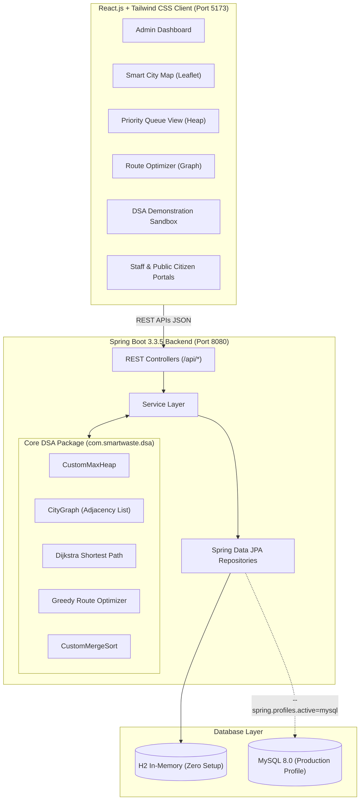

# 🏙️ Smart Waste Collection and Management System

[](https://openjdk.org/)
[](https://spring.io/)
[](https://reactjs.org/)
[](https://tailwindcss.com/)
[](https://leafletjs.com/)
[](https://www.mysql.com/)

A modern, full-stack, enterprise-grade Smart City waste management and routing optimization platform powered by **Core Data Structures and Algorithms (DSA)** in pure Java.

---

## 📑 Table of Contents
1. [Project Overview](#1-project-overview)
2. [Core Data Structures & Algorithms Implementation](#2-core-data-structures--algorithms-implementation)
3. [System Architecture](#3-system-architecture)
4. [User Roles & Security Matrix](#4-user-roles--security-matrix)
5. [Modules Overview](#5-modules-overview)
6. [Database Schema & ER Relationships](#6-database-schema--er-relationships)
7. [Installation & Execution Guide](#7-installation--execution-guide)
8. [REST API Documentation](#8-rest-api-documentation)
9. [Faculty Evaluation & Demonstration Guide](#9-faculty-evaluation--demonstration-guide)

---

## 1. Project Overview

Municipal solid waste management is one of the most critical logistical challenges facing modern urban ecosystems. Overflowing dustbins lead to health hazards, environmental pollution, and severe traffic congestion.

The **Smart Waste Collection and Management System** simulates a real-world municipal smart city infrastructure where hundreds of dustbins are distributed across urban sectors. Each dustbin is equipped with simulated ultrasonic IoT fill-level sensors. When bins approach capacity:
- The system automatically triggers **Priority Queues (Max Heap)** to identify high-urgency zones.
- Solves point-to-point road connectivity using **Dijkstra's Shortest Path Algorithm**.
- Generates multi-stop vehicle collection tours using a **Priority-Aware Greedy Route Optimizer** under vehicle payload constraints.
- Provides citizens with an issue reporting portal and collection staff with a turn-by-turn dispatch dashboard.

---

## 2. Core Data Structures & Algorithms Implementation

This project implements core algorithms natively in Java under `com.smartwaste.dsa`:

### 2.1. Custom Max Heap (Priority Queue) — `CustomMaxHeap.java`
- **Application Role**: Automatically organizes dustbins by filling urgency and timestamp. When a bin's fill level changes, it is dynamically sifted into its optimal position in the binary heap.
- **Operations Implemented**:
  - `insert(HeapNode node)`: Dynamic expansion, Sift-Up ($O(\log N)$)
  - `extractMax()`: Removes highest-priority dustbin, moves last leaf to root, Sift-Down ($O(\log N)$)
  - `peek()`: Returns root node without removal ($O(1)$)
  - `updatePriority(dustbinCode, newFill)`: Search and reheapify ($O(N)$ search + $O(\log N)$ sift)
  - `rebuild(List<HeapNode> nodes)`: Bottom-up linear heap construction ($O(N)$)
- **Tie-Breaking Rule**: When two dustbins have identical filling percentages (e.g., both at 100%), the tie-breaker evaluates the report timestamp (earlier report has priority) or Euclidean proximity to the central depot.
- **Complexity**:
  | Operation | Time Complexity | Space Complexity |
  | :--- | :--- | :--- |
  | Insert | $O(\log N)$ | $O(1)$ auxiliary |
  | Extract Max | $O(\log N)$ | $O(1)$ auxiliary |
  | Peek | $O(1)$ | $O(1)$ auxiliary |
  | Build Heap | $O(N)$ | $O(N)$ storage |

---

### 2.2. Weighted Graph (Adjacency List) — `CityGraph.java`
- **Application Role**: Models the urban road network connecting central municipal depots, transfer stations, major crossroads, and access lanes to collection points.
- **Representation**: `Map<String, Vertex>` for $O(1)$ vertex lookup and `Map<String, List<Edge>>` for adjacency lists. Supports two-way avenues and one-way streets.
- **Complexity**:
  - Vertex insertion: $O(1)$
  - Edge insertion: $O(1)$
  - Space complexity: $O(V + E)$ where $V$ is vertices and $E$ is road segments.

---

### 2.3. Dijkstra's Shortest Path Algorithm — `Dijkstra.java`
- **Application Role**: Computes the minimum road distance between any two locations in the city.
- **Implementation**: Utilizes a Min-Heap Priority Queue to greedily relax vertices. Tracks predecessor pointers for complete path reconstruction and generates a step-by-step trace table (`SETTLED`, `UPDATED`, `REMAINED_SHORTER`) for the visual DSA Sandbox.
- **Complexity**:
  - Time Complexity: $O((V + E) \log V)$
  - Space Complexity: $O(V)$ for distance maps and predecessors.

---

### 2.4. Priority-Aware Greedy Route Optimizer — `GreedyRouteOptimizer.java`
- **Algorithmic Distinction**: Dijkstra solves the single-source shortest path problem. Multi-stop waste collection across multiple target bins is an NP-Hard problem (related to the Travelling Salesperson Problem / Capacitated Vehicle Routing Problem).
- **Heuristic Workflow**:
  1. Start vehicle at municipal depot (e.g. `DEPOT-01`).
  2. Filter uncollected dustbins exceeding collection threshold (e.g., $\ge 75\%$) that fit vehicle remaining payload capacity.
  3. Compute Dijkstra distance to each candidate.
  4. Evaluate greedy fitness score:
     $$\text{Score} = \frac{\text{PriorityWeight} \times 100}{\text{DijkstraDistance}_{\text{km}} + 0.5}$$
     where $\text{PriorityWeight} \in \{ \text{Critical}: 4.0, \text{High}: 3.0, \text{Medium}: 2.0, \text{Low}: 1.0 \}$.
  5. Select the highest scoring stop, advance truck, accumulate load, and repeat.
  6. Compute Dijkstra shortest path back to depot for unloading.

---

### 2.5. Custom Merge Sort — `CustomMergeSort.java`
- **Application Role**: Stable $O(N \log N)$ sorting of dustbins by fill level, collection logs by timestamp, and location clusters.
- **Features**: Generates recursive divide-and-conquer telemetry (comparison counts, merge step records, and elapsed nanoseconds) displayed in the DSA Visualizer.

---

## 3. System Architecture



---

## 4. User Roles & Security Matrix

| Role | Target Interface | Capabilities |
| :--- | :--- | :--- |
| **Administrator** | `/` (Dashboard, Map, Bins, Routes, Fleet) | Full municipal control: monitor telemetry, edit bins, generate tours, manage fleet/staff, review grievances. |
| **Collection Staff** | `/staff-portal`, `/map`, `/history` | View assigned compactor truck, inspect urgent route stops, click "Mark as Collected" (resets bin to 0%). |
| **Public Citizen** | `/public-portal`, `/report-complaint`, `/track-complaint` | Report overflowing bins with photo URL, track complaint status using unique tracking code. |

*Switch between all 3 roles seamlessly using the top-right role switcher.*

---

## 5. Modules Overview

1. **Module 1: Admin Dashboard**: 8 real-time KPI metrics, fill-level donut chart, 7-day daily collection bar chart, area-wise tonnage, and IoT sensor quick simulator.
2. **Module 2: Smart City Map**: Interactive OpenStreetMap rendered via Leaflet. Color-coded markers (Green $\le 30\%$, Yellow $31-74\%$, Orange $75-89\%$, Red $\ge 90\%$), live vehicle indicators, coordinate search, and filters.
3. **Module 3: Dustbin Management**: Complete CRUD operations, pagination, fill-percentage sort, status filter, and per-bin sensor slider.
4. **Module 4: Smart Priority Management**: Live Custom Max-Heap tree visualizer, array memory layout ($[0..N-1]$), and next urgent collection queue.
5. **Module 5: Graph & Route Optimization**: Adjacency list city graph, interactive multi-stop vehicle collection tour generator, and Dijkstra point-to-point pathfinder.
6. **Module 6: Vehicle Management**: Compactor trucks, mini tippers, status management (`AVAILABLE`, `ON_DUTY`, `MAINTENANCE`), driver assignments.
7. **Module 7: Staff Management**: Sanitation workers registry, vehicle assignments, and completed tasks counter.
8. **Module 8: Public Complaint Management**: Citizen grievance portal, photo evidence display, and administrative status transitions.
9. **Module 9: Collection History**: Auditable historical log of emptied bins, previous fill percentages, waste quantities, and CSV export.
10. **Module 10: Analytics & Reports**: Municipal KPIs, fleet operational rates, area waste distribution, and turn-around analytics.
11. **Module 11: DSA Visualizer Sandbox**: Interactive testbed for Merge Sort with custom input arrays, Dijkstra step-by-step trace, and heap structure inspection.

---

## 6. Database Schema & ER Relationships

The database is normalized across **9 tables**:
1. `users`: Administrative and field personnel credentials and roles (`ADMIN`, `STAFF`, `PUBLIC`).
2. `city_locations`: Depots, transfer stations, major road intersections, and landfills.
3. `dustbins`: Location coordinates, 500L capacity, current waste level, category, status, priority.
4. `vehicles`: Registration number, vehicle type, payload capacity in kg, status.
5. `collection_staff`: Employee records, contact info, assigned vehicle, completion counters.
6. `collection_tasks`: Dispatched multi-stop routes, stop counts, distance, duration.
7. `complaints`: Citizen grievance submissions with photo URL, status workflow, and staff assignment.
8. `collection_history`: Auditable records of emptied bins, timestamp, previous fill, and waste cleared.
9. `road_connections`: Weighted edges between city locations with distance in kilometers.

A complete DDL script is provided in [`database/schema.sql`](file:///d:/projects/ADSA/database/schema.sql).

---

## 7. Installation & Execution Guide

### Prerequisites
- **Java**: JDK 21 or later
- **Node.js**: v18+ (tested on Node v24.20.0, npm 11.19.0)
- **Database**: Embedded H2 is enabled by default for zero-setup execution. MySQL 8.0 is optionally supported via `--spring.profiles.active=mysql`.

---

### Option A: One-Click Launch (Recommended)

1. Double-click **`start-backend.bat`** (or run `powershell -File .\run-backend.ps1`).
   - The Spring Boot server starts on `http://localhost:8080`.
   - Automatically seeds 32 dustbins, 13 city intersections/depots, 16 road connections, 6 vehicles, 8 staff members, and 12 history logs.
2. Double-click **`start-frontend.bat`** (or open a terminal in `frontend` and run `npm run dev`).
   - The React UI starts on `http://localhost:5173`.
3. Open your browser at **`http://localhost:5173`**.

---

### Option B: Manual Terminal Execution

#### 1. Compile and Run the Backend
```powershell
# From project root
powershell -ExecutionPolicy Bypass -File .\build-backend.ps1
powershell -ExecutionPolicy Bypass -File .\run-backend.ps1
```

#### 2. Start the Frontend
```powershell
cd frontend
npm run dev
```

---

## 8. REST API Documentation

| Method | Endpoint | Description |
| :--- | :--- | :--- |
| `GET` | `/api/analytics/dashboard` | Returns full municipal stats, distribution maps, and daily trends |
| `GET` | `/api/dustbins` | List all 32 smart dustbins with telemetry |
| `POST` | `/api/dustbins/simulate-sensor` | Update dustbin fill percentage & triggers Max Heap re-balance |
| `POST` | `/api/dustbins/simulate-random` | Simulates randomized IoT fluctuations across the city |
| `GET` | `/api/priority` | Retrieve current Priority Queue sorted by Custom Max Heap |
| `GET` | `/api/priority/tree` | Returns visual heap array and tree parent-child links |
| `POST` | `/api/priority/extract-max` | Extracts highest-priority dustbin from root node |
| `POST` | `/api/routes/shortest-path` | Dijkstra shortest path between any 2 locations |
| `POST` | `/api/routes/optimize` | Multi-stop greedy priority-aware route optimizer tour |
| `GET` | `/api/routes/graph` | Returns city road graph vertices and adjacency list |
| `GET` | `/api/vehicles` | List all garbage collection vehicles |
| `GET` | `/api/staff` | List all municipal collection staff |
| `POST` | `/api/complaints` | Citizen submits grievance report |
| `GET` | `/api/complaints/track/{code}` | Track complaint by code |
| `POST` | `/api/collections/complete` | Complete pickup: resets bin to 0%, logs history |
| `POST` | `/api/dsa/mergesort` | Runs custom Merge Sort with comparison and merge telemetry |

---

## 9. Faculty Evaluation & Demonstration Guide

To showcase this application during college project evaluation or viva:

1. **Dashboard & Live Telemetry**:
   - Open `http://localhost:5173`.
   - Point out the 8 statistics cards and the live charts.
   - Click the **"Simulate Sensor Update"** button in the top navbar to demonstrate IoT level fluctuation and real-time alerts.

2. **Smart City Map (Module 2)**:
   - Navigate to **Smart City Map**.
   - Show color-coded markers (Red for $\ge 90\%$ critical bins, orange, yellow, green).
   - Click on any marker to show coordinates, capacity, fill percentage, and assigned worker.
   - Use the search bar to locate specific dustbins (e.g. `B101`, `B104`).

3. **Core DSA: Custom Max Heap (Module 4)**:
   - Navigate to **Priority Management**.
   - Show the **Root Node [Index 0]** spotlighting the most urgent collection task.
   - Point out the **Binary Max-Heap Array Memory Buffer** displaying index relationships:
     $$\text{Parent}(i) = \lfloor(i-1)/2\rfloor, \quad \text{Left}(i) = 2i+1, \quad \text{Right}(i) = 2i+2$$
   - Click **"Extract Max Priority"** to show $O(\log N)$ sift-down root extraction.

4. **Core DSA: Graph & Route Optimization (Module 5)**:
   - Navigate to **Route Optimization**.
   - Select a vehicle and click **"Calculate Optimized Route"**.
   - Show how the Priority-Aware Greedy Optimizer selects stops and chains Dijkstra road segments, returning back to `DEPOT-01`.
   - Switch to **"Dijkstra Shortest Path"** tab and compute the shortest distance between `DEPOT-01` and `INT-06`.

5. **DSA Demonstration Sandbox (Module 11)**:
   - Navigate to **DSA Visualizer Sandbox**.
   - Test **Merge Sort** with custom numbers to demonstrate divide-and-conquer steps, comparison counts, and elapsed nanoseconds.
   - Review the academic explanation highlighting why TSP is NP-Hard and how the heuristic balances urgency and distance.

6. **Role Perspectives**:
   - Switch role to **Staff** to view the collection worker workflow and click **"Mark as Collected"** to reset a dustbin to 0%.
   - Switch role to **Public** to file and track a citizen complaint.
